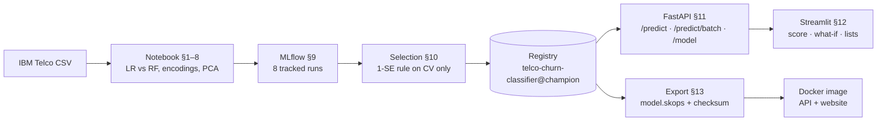

# Telco churn: drivers, PCA axes, and a deployed risk desk

Group project, MSc Cybersecurity & Data Science (ESAIP, Angers).
**Pinninti Sai Anish · Paravasthu Vamsi Krishna Suri · Kola Karan**

We predict which customers of a telecom operator will leave, using the IBM Telco Customer Churn dataset (7,043 customers, 26.5 % churn). The analysis compares logistic regression and random forest, then asks whether PCA's behavioural axes keep the signal. The project goes on to ship the result:

- every configuration is tracked in **MLflow**;
- the champion is chosen by a rule fixed in advance and registered;
- the champion is served by a **FastAPI** service and a **Streamlit** website;
- everything is packaged as one **Docker** image.

The full write-up is in [`report/`](report/Churn_Drivers_and_PCA_Behavioural_Axes_Group_Report.pdf).

## Run it

**Website and API, one command** (needs only Docker):

```
docker run -p 8501:8501 -p 8000:8000 luffu90/churn-risk-desk:1.0
```

Then open the website at <http://localhost:8501> and the API docs at <http://localhost:8000/docs>. If a port is taken, change the number before the colon, for example `-p 8001:8000`.

The same image is also published on GitHub Container Registry by CI, for Intel/AMD and Apple-silicon machines (see **Packages** on this repo's page):

```
docker run -p 8501:8501 -p 8000:8000 ghcr.io/ar-base/churn-risk-desk:1.0
```

Tags: `1.0`, `latest`, and `sha-<commit>` for each build. CI publishes only after the image has passed its tests.

**Without a registry:** download `churn-risk-desk-1.0-amd64.tar.xz` from this repo's **Releases**, then:

```
docker load -i churn-risk-desk-1.0-amd64.tar.xz
docker run -p 8501:8501 -p 8000:8000 churn-risk-desk:1.0
```

**Notebook:** open [`notebooks/telco_churn_pca_mlflow_api.ipynb`](notebooks/telco_churn_pca_mlflow_api.ipynb) in Google Colab and choose *Runtime → Run all* (about 3 minutes). It downloads the data and reproduces every table and figure. It then starts MLflow, the API and the website, and in §13 it rebuilds the Docker build folder from the registered model.

**Build the image yourself:** see [`docker/README.md`](docker/README.md).

## How it fits together



## Results

5-fold stratified CV on the training set (seed 42); the 1,409-customer test set was scored once per configuration and never used for selection.

| Configuration | CV ROC-AUC | CV SD | Test ROC-AUC | Test recall @ 0.5 |
|---|---|---|---|---|
| RandomForest, one-hot (A) | 0.8477 | 0.0099 | 0.8440 | 0.508 |
| RandomForest, compact (B) | 0.8468 | 0.0112 | 0.8460 | 0.500 |
| **LogReg, compact (B): champion** | **0.8463** | 0.0142 | **0.8421** | **0.562** |
| LogReg, one-hot (A) | 0.8462 | 0.0141 | 0.8417 | 0.567 |
| LogReg, B + 15 PCs (90 % variance) | 0.8443 | 0.0127 | 0.8373 | 0.535 |
| RandomForest, B + 15 PCs | 0.8327 | 0.0110 | 0.8252 | 0.465 |
| LogReg, B + 2 PCs | 0.8313 | 0.0110 | 0.8216 | 0.487 |
| RandomForest, B + 2 PCs | 0.8166 | 0.0160 | 0.8101 | 0.473 |

**Why logistic regression wins.** The best random forest leads by about 0.001 CV ROC-AUC, far inside one standard error (about 0.004). Under the rule we fixed before running, that is a tie. The tie goes to the simpler model, which we can also explain to a customer.

## Repository

```
notebooks/   the full analysis + MLflow + API + website + Docker export (executed, with outputs)
docker/      Docker build context: Dockerfile, pinned requirements, app code, exported model, self-test
report/      group report (PDF)
.github/     CI: builds the image, lints the Dockerfile, runs and smoke-tests the container, then publishes it
             to ghcr.io and attaches it as a compressed file to the v1.0 release
```

## Engineering notes

- **Reproducible.**
  - Fixed seed, frozen folds, and a test-set fingerprint checked before selection.
  - The image pins the library versions that trained the model.
- **Traceable.** The image is labelled with the MLflow run ID and the model's SHA-256. `python selftest.py` runs inside every build and checks the scores of 25 real test customers against the notebook.
- **Safe defaults.**
  - The model is saved with skops (no pickle), with only the needed types allowed to load.
  - Every API input is validated, including impossible service combinations.
  - The container runs as a non-root user with read-only code.
  - There are no secrets or customer data in the image.

## Limitations

- **Snapshot data.** Tenure and charges are measured when churn happens, so scores for current customers need monitoring before anyone acts on them.
- **Associations, not causes.** The model's reasons and the website's what-if results show patterns in past customers, not the effects of actions.
- **Demo use only.** The website and API have no login. Use them for demos and coursework, not to expose real customer data.
